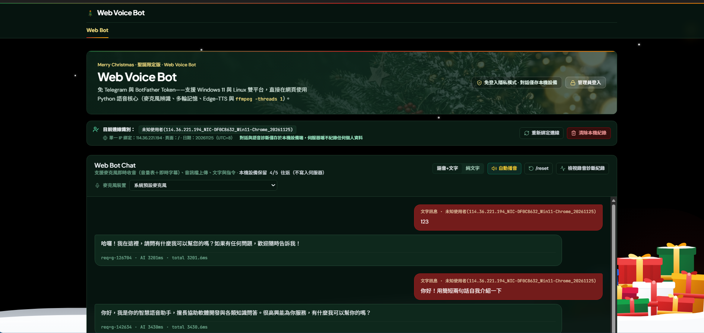

# Web Voice Bot

 - 免 Telegram 與 BotFather Token——同時支援 **Windows 11** 與 **Linux / macOS** 的全端網頁語音助手，內建完整的 Python 語音管線（`ConversationStore` 多輪記憶、Edge-TTS、可抽換 `TTSProvider`、`ffmpeg -threads 1` 音訊正規化、Redis fail-open 配額保護與動態熱更新設定）。
 - 
---

## 快速啟動（3 步驟，內建防呆檢查）

### 事前準備
- **Node.js 20+**（https://nodejs.org/）
- **Python 3.11+**（Windows 安裝時請勾選 `Add python.exe to PATH`）
- **ffmpeg**（語音錄音轉檔與 MP3 合成需要）：
  - Windows 11：`winget install Gyan.FFmpeg`（裝完請重開終端機）
  - Ubuntu / Debian：`sudo apt update && sudo apt install -y ffmpeg python3-venv`
- **一組免費 Gemini API Key**：https://aistudio.google.com/apikey

### Windows 11 一鍵啟動
```powershell
git clone https://github.com/Ya-wenWu/telegram-voice-bot.git
cd telegram-voice-bot
powershell -ExecutionPolicy Bypass -File .\start-win11.ps1
```

### Linux / macOS 一鍵啟動
```bash
git clone https://github.com/Ya-wenWu/telegram-voice-bot.git
cd telegram-voice-bot
chmod +x ./start-linux.sh && ./start-linux.sh
```

啟動完成後，用瀏覽器開啟 **http://localhost:3000** 即可直接語音與文字對話。

---

## 內建管理員防呆與安全保護

為了避免使用者下載自架時踩坑或不小心把金鑰推回 GitHub，本專案內建四層防護：

1. **啟動腳本隱藏輸入金鑰**：第一次執行 `start-win11.ps1` 或 `./start-linux.sh` 時，若偵測到 `.env` 尚未設定有效 `GEMINI_API_KEY`（包含空值、範例佔位字或誤貼空白），會直接於終端機以**隱藏輸入**引導設定並寫入本機 `.env`（Linux 自動設定 `chmod 600` 僅限本人讀寫），不會留在終端機畫面紀錄中。
2. **一鍵環境與安全健檢（`npm run doctor`）**：隨時執行 `npm run doctor`，一次檢查 Node.js 版本、Python 3.11+、虛擬環境相依套件、`ffmpeg`、`.env` 金鑰格式、Port 3000 佔用狀況與 Git 追蹤安全（絕不印出金鑰明文）。
3. **Git Pre-Commit 防洩漏攔截（`.githooks/pre-commit` + `.gitleaks.toml`）**：啟動腳本會自動啟用內建 Git Hook；若已透過 `DeveloperSetting/` 腳本安裝 Gitleaks 會優先串接 `gitleaks protect --staged`，未安裝時仍有零相依備援規則攔截 `.env`、`firebase-applet-config.json`、`*service-account*.json`、私鑰與 `AIza...` 金鑰。
4. **伺服器與網頁即時診斷**：即使手動執行 `npm run dev` 略過啟動腳本，後端 `/api/bot/status` 仍會即時檢測環境缺漏並在網頁上方顯示明確的修正步驟，不會丟出難懂的錯誤堆疊。
5. **開發者環境自動化工具（`DeveloperSetting/`）**：提供 Windows（Visual Studio）、Linux 與 macOS 開發機初始化腳本（自動配置 Gitleaks、SonarQube for IDE 與 `npm ci --ignore-scripts` 安全還原）；詳細本機啟動說明另見 `README_LOCAL_RUN.md`。

---

## Prompt Injection 與 AI 安全防護

本專案內建多層 Prompt Injection 防線（同時涵蓋文字輸入與語音辨識後的轉錄內容）：

1. **架構隔離（最小權限）**：AI 模型僅負責純文字回覆，**未掛載任何檔案讀寫、Shell 執行或讀取環境變數工具**，系統提示詞中亦不包含任何 API 金鑰，從架構層阻斷 RCE 與金鑰外洩。
2. **輸入淨化與預篩攔截（`promptGuard.ts`）**：自動剝除零寬／雙向隱藏字元、限制單則訊息長度（防 Token 轟炸），並在送交模型前攔截指令覆寫、越獄模式、系統提示詞套取、金鑰套取與偽造 `[SYSTEM]` 角色標籤；被攔截的攻擊**不耗費 API 額度、也不寫入多輪記憶**（防記憶污染）。
3. **語音防間接注入（Audio STT Lock）**：語音轉文字階段鎖定獨立 `STT_SYSTEM_INSTRUCTION` 僅做逐字轉錄、不執行語音中的指令，且轉錄文字同樣經過 Prompt Injection 偵測。
4. **不可信資料邊界與輸出遮罩**：所有使用者訊息以 `<user_message>...</user_message>` 隔離並跳脫閉合標籤；模型輸出回傳前再經敏感金鑰遮罩與長度上限檢查。
5. **本機綁定、速率限制與端點保護**：本機啟動預設僅監聽 `127.0.0.1`；除 `/health`、`/ready` 外，所有路由（`/api/*`、`/metrics`、原始碼 ZIP）對非本機連線（含經反向代理轉入、雲端環境）都要求 `WEB_API_TOKEN`，細節見 [規格文件](telegram-voice-bot/Spec_bot_management_web.md)；同時內建每 IP 滑動視窗限流（20 次／分鐘）與 800ms POST 防抖，對外公開部署亦可設定 `ADMIN_API_TOKEN` 鎖定動態設定與測試端點。

---

## 常用指令

| 指令 | 說明 |
| :--- | :--- |
| `npm run doctor` | 執行跨平台環境與安全防呆健檢 |
| `npm run dev` | 啟動開發伺服器（預設 `http://localhost:3000`） |
| `npm run build` | 編譯前端正式版輸出至 `dist/` |
| `npm run lint` | 執行 TypeScript 型別檢查 |
| `npm run clean` | 跨平台清理 `dist/` 編譯快取 |

---

## 雲端部署提醒

- 本機自架時，API Key 存放於受 `.gitignore` 保護的本機 `.env`。
- 若要部署至雲端（例如 Cloud Run、Render、Fly.io 或 GitHub Actions），請改用平台原生的 **Secrets / Secret Manager** 注入 `GEMINI_API_KEY`，切勿將 `.env` 打包進映像檔或提交至儲存庫。
- 雲端部署**必須**同時以 Secrets 設定 `WEB_API_TOKEN`（建議 `openssl rand -hex 32`）；未設定時，除 `/health`、`/ready` 外的路由都會回 403。網頁會在需要時跳出視窗請你輸入 token。
